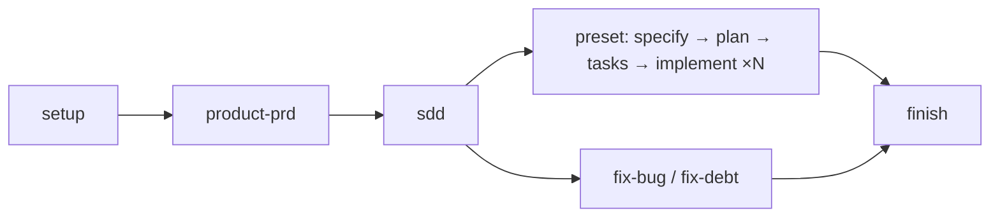

# spec-kit-extension-sdd-workflow

A [Spec Kit](https://github.com/github/spec-kit) extension that adds project
inception, health management and the parallel-work lifecycle. It pairs with
[`spec-kit-preset-sdd-workflow`](https://github.com/fabfdev/spec-kit-preset-sdd-workflow),
which replaces the feature commands.

Each tracked item is one markdown file under `docs/kanban/`, committed with the
work, so `git log` is the history. No external services. Hot-path commands are
at most 3 KB each and run one item per session; `/clear` between them.

## Commands

| Command | When | Produces |
|---------|------|----------|
| `/speckit.sdd-workflow.setup` | once per project | `docs/kanban/README.md` (schema), `docs/health/scan.md`, `.worktrees/` in `.gitignore` |
| `/speckit.sdd-workflow.product-prd` | once | `docs/core/prd.md` |
| `/speckit.sdd-workflow.sdd` | once, after the PRD | `docs/core/sdd.md`, the architecture authority the preset commands read |
| `/speckit.sdd-workflow.fix-bug` | per bug | `docs/kanban/bug-[slug].md`, worktree `bugfix/[slug]`, regression test, one commit, PR |
| `/speckit.sdd-workflow.fix-debt` | per debt | `docs/kanban/debt-[slug].md`, worktree `refactor/[slug]`, one commit, PR |
| `/speckit.sdd-workflow.worktrees` | any time | the live board: worktrees with their kanban status |
| `/speckit.sdd-workflow.finish` | after review | confirmed squash merge, default branch updated, kanban closed, worktree removed |
| `/speckit.sdd-workflow.import-notion` | once, v1.x only | migrates a Notion board into `docs/kanban/` |

## Lifecycle



Status: features go `planned → specced → ready → in-progress → in-review → completed`;
bugs and debt go `reported → in-progress → resolved`. Any item can be `abandoned`.

## Installation

```bash
specify extension add sdd-workflow --from https://github.com/fabfdev/spec-kit-extension-sdd-workflow/archive/refs/tags/v4.0.0.zip
specify preset add sdd-workflow --from https://github.com/fabfdev/spec-kit-preset-sdd-workflow/archive/refs/tags/v4.0.0.zip
```

### Updating every project and the global skills

Run this from the folder that contains both source checkouts:

```bash
python3 spec-kit-extension-sdd-workflow/scripts/update_installations.py          # preview
python3 spec-kit-extension-sdd-workflow/scripts/update_installations.py --apply  # back up, then replace
```

The script finds the projects under `~/AIProjects` that have the workflow
installed, and the `~/.agents/skills/speckit-*` copies. It backs them up to
`~/.sdd-workflow-backups/` and reinstalls them through the Spec Kit CLI,
keeping priority and enabled state. Application code and feature documents
are not touched. Reopen agent sessions afterwards.

See `CHANGELOG.md`.

## License

MIT
